# AS-IS dos processos-piloto (reconstruído do SEI)

Gerado por `scripts/asis_piloto.py`. Horas = modelo por conteúdo (laudas autorais × complexidade + leitura de insumos + fontes externas), hipótese a calibrar. du = dias úteis. Nos fluxos, cada caixa é uma passagem em que a unidade juntou documento; vermelho = espera dominante (≥ 20 du com trabalho < 5% da capacidade); amarelo = a peça registra sinal de perda (complementação, diligência, prazo, reiteração).

## P01 — Reajuste tarifário anual (saneamento e gás)

| Processo SEI | Caso | Lead time (du) | Documentos | Laudas produzidas | Horas (modelo) | Eficiência do ciclo | Tempo em espera dominante |
|---|---|---|---|---|---|---|---|
| SEI-480002/001914/2024 | típico | 327 | 63 | 149 | 113 | 5.8% | 54% |
| SEI-220007/004053/2022 | crítico | 698 | 66 | 188 | 118 | 2.8% | 82% |

**Onde está o trabalho:** Análise jurídica 40%; Análise econômico-financeira 21%; Relatoria e decisão 18%; Comunicação 9%; Encaminhamento 6%.
**Competências exigidas (por horas):** Jurídico-regulatória (especialista); Redação oficial (intermediário); Gestão processual (intermediário); Econômico-financeira e tarifária (especialista).
**Insumos:** documento do processo (86); documento da regulada (29); norma ou contrato (23); precedente ou jurisprudencia (1).
**Ferramentas e técnicas mais usadas:** conferência documental (20); análise normativa (16); cálculo tarifário paramétrico (5); análise de precedentes (2); redação oficial (2); interpretação sistemática (1).
**Exemplos de cálculo:** Cálculo do índice de reajuste tarifário  IR  via fórmula paramétrica, apurando o percentual de 10,37%; Cálculo do valor faturado de água por faixas de consumo por categoria  domiciliar, comercial, industrial, púb…; Aplicação do percentual de 4,80% na tarifa mínima praticada para obter a nova tarifa básica de R$ 4,95/m³; Cálculo do Índice de Reajuste Contratual  IRC  pela CAPET apurando o percentual de 5,9005%.
**Sinais de perda nas peças:** aguardando outra unidade (9); diligência externa (7); pedido de complementação (5); reiteração (3); refazimento (3).

### SEI-480002/001914/2024 — caso típico

REAJUSTE TARIFÁRIO - IRC E ITS  - 2024

### SEI-220007/004053/2022 — caso crítico

REAJUSTE TARIFÁRIO PARA VIGORAR A PARTIR DE JANEIRO DE 2023

## P06 — Fiscalização técnica de campo (programada e por demanda)

| Processo SEI | Caso | Lead time (du) | Documentos | Laudas produzidas | Horas (modelo) | Eficiência do ciclo | Tempo em espera dominante |
|---|---|---|---|---|---|---|---|
| SEI-480002/007520/2025 | típico | 187 | 22 | 63 | 63 | 5.6% | 66% |
| SEI-480002/005546/2024 | crítico | 483 | 38 | 70 | 75 | 2.6% | 82% |

**Onde está o trabalho:** Relatoria e decisão 29%; Análise jurídica 20%; Fiscalização de campo 19%; Análise técnica de engenharia 13%; Comunicação 12%.
**Competências exigidas (por horas):** Engenharia de gás e segurança (intermediário); Gestão processual (intermediário); Jurídico-regulatória (especialista); Redação oficial (intermediário).
**Insumos:** documento do processo (45); norma ou contrato (18); documento da regulada (10); vistoria ou campo (3); base externa (1).
**Ferramentas e técnicas mais usadas:** conferência documental (17); análise normativa (9); vistoria in loco (4); redação oficial (3); análise de precedentes (2); análise normativa e de razoabilidade (1).
**Sinais de perda nas peças:** diligência externa (12); pedido de complementação (7); reiteração (2); aguardando outra unidade (2); prazo concedido (1).

### SEI-480002/007520/2025 — caso típico

RELATÓRIO DE FISCALIZAÇÃO P-125/25 E TERMO DE NOTIFICAÇÃO 018/2025\n\n\nBombeiros não emitem certidão

```mermaid
flowchart LR
  t0["CAENE<br/>Fiscalizar estação de transferência de gás da concessionária<br/>25.1 h · 10 du"]
  class t0 perda
  t1["SCEXEC<br/>encaminhar autos para manifestação da procuradoria<br/>0.6 h · 32 du"]
  class t1 espera
  t2["PROC<br/>emitir parecer jurídico sobre irregularidade em fiscalização<br/>10.6 h · 24 du"]
  class t2 perda
  t3["SCEXEC<br/>Encaminhar processo ao Gabinete do Conselheiro Relator<br/>0.4 h · 23 du"]
  class t3 espera
  t4["CONS-02<br/>Intimar concessionária para apresentar razões finais<br/>1.1 h · 8 du"]
  t5["CONS-02<br/>relatar processo regulatório e propor diligência<br/>18.7 h · 7 du"]
  class t5 perda
  t6["SCEXEC<br/>Solicitar informações sobre regularização de documentação<br/>3.5 h · 2 du"]
  class t6 perda
  t7["CAENE<br/>Encaminhar processo à SECEX após ciência<br/>0.4 h · 0 du"]
  t8["SCEXEC<br/>informar cumprimento de diligências da Deliberação 5053/2026<br/>2.3 h · 0 du"]
  class t8 perda
  t0 --> t1
  t1 --> t2
  t2 --> t3
  t3 --> t4
  t4 --> t5
  t5 --> t6
  t6 --> t7
  t7 --> t8
  classDef espera fill:#f8d7da,stroke:#b02a37
  classDef perda fill:#fff3cd,stroke:#b58105
```

### SEI-480002/005546/2024 — caso crítico

FISCALIZAÇÃO CAENE - ESTAÇÃO DE REGULAGEM E MEDIÇÃO - SANTA CRUZ

```mermaid
flowchart LR
  t0["CAENE<br/>fiscalizar estação de regulagem e medição<br/>19.8 h · 32 du"]
  class t0 perda
  t1["SCEXEC<br/>E-mail<br/>0.2 h · 0 du"]
  t2["INEA/PRESI<br/>Despacho de Encaminhamento de Processo<br/>0.1 h · 0 du"]
  t3["INEA/DIRLAM<br/>Despacho de Encaminhamento de Processo<br/>0.1 h · 1 du"]
  t4["INEA/SERVARAT<br/>Manifestação 1146<br/>0.2 h · 2 du"]
  t5["INEA/GERLRAC<br/>Despacho de Encaminhamento de Processo<br/>0.1 h · 1 du"]
  t6["INEA/DIRLAM<br/>Despacho de Encaminhamento de Processo<br/>0.1 h · 0 du"]
  t7["INEA/PRESI<br/>Ofício - NA 2015<br/>0.8 h · 5 du"]
  t8["CAENE<br/>Analisar regularidade documental de estação de gás<br/>8.4 h · 0 du"]
  class t8 perda
  t9["SCEXEC<br/>Juntar Ofício .INEA/PRESI Nº2326<br/>0.1 h · 0 du"]
  t10["SCEXEC<br/>encaminhar processo para manifestação jurídica<br/>1.4 h · 0 du"]
  t11["PROC<br/>emitir parecer juridico sobre fiscalizacao da concessionaria<br/>16.2 h · 17 du"]
  class t11 perda
  t12["SCEXEC<br/>Encaminhar processo para conselheiro relator<br/>0.4 h · 5 du"]
  t13["CONS-02<br/>notificar concessionária para apresentar razões finais<br/>1.1 h · 106 du"]
  class t13 espera
  t14["CONS-02<br/>propor aplicação de penalidade a concessionária em processo…<br/>19.8 h · 7 du"]
  class t14 perda
  t15["SCEXEC<br/>Solicitar informações sobre laudos ao CBMERJ<br/>3.4 h · 2 du"]
  class t15 perda
  t16["CAENE<br/>Devolver processo à SECEX<br/>0.4 h · 0 du"]
  t17["SCEXEC<br/>informar providências adotadas para cumprimento de delibera…<br/>2.4 h · 0 du"]
  t0 --> t1
  t1 --> t2
  t2 --> t3
  t3 --> t4
  t4 --> t5
  t5 --> t6
  t6 --> t7
  t7 --> t8
  t8 --> t9
  t9 --> t10
  t10 --> t11
  t11 --> t12
  t12 --> t13
  t13 --> t14
  t14 --> t15
  t15 --> t16
  t16 --> t17
  classDef espera fill:#f8d7da,stroke:#b02a37
  classDef perda fill:#fff3cd,stroke:#b58105
```

## P36 — Regulação e fiscalização comercial (faturamento, medição, corte, religação e tarifa social)

| Processo SEI | Caso | Lead time (du) | Documentos | Laudas produzidas | Horas (modelo) | Eficiência do ciclo | Tempo em espera dominante |
|---|---|---|---|---|---|---|---|
| SEI-480002/008679/2025 | típico | 166 | 28 | 97 | 65 | 6.6% | 29% |

**Onde está o trabalho:** Análise jurídica 54%; Relatoria e decisão 29%; Encaminhamento 6%; Comunicação 6%; Instrução processual 5%.
**Competências exigidas (por horas):** Redação oficial (intermediário); Jurídico-regulatória (especialista); Gestão processual (básico).
**Insumos:** documento do processo (20); documento da regulada (7); norma ou contrato (7); precedente ou jurisprudencia (2).
**Ferramentas e técnicas mais usadas:** conferência documental (6); análise normativa (5); análise de precedentes (2); redação oficial (2).
**Sinais de perda nas peças:** pedido de complementação (1).

### SEI-480002/008679/2025 — caso típico

CONTRATO DE CONDIÇÕES ESPECIAIS PARA A PRESTAÇÃO DE ABASTECIMENTO DE ÁGUA POTÁVEL A GRANDES USUÁRIOS. CONCESSIONÁRIA RIO + SANEAMENTO E TERNIUM BRASIL LITDA.

## P35 — Gestão de interrupções e crises de abastecimento

| Processo SEI | Caso | Lead time (du) | Documentos | Laudas produzidas | Horas (modelo) | Eficiência do ciclo | Tempo em espera dominante |
|---|---|---|---|---|---|---|---|
| SEI-220007/002039/2022 | típico | 922 | 34 | 26 | 39 | 0.7% | 93% |
| SEI-220007/000992/2022 | crítico | 939 | 128 | 156 | 138 | 2.5% | 75% |

**Onde está o trabalho:** Relatoria e decisão 34%; Análise jurídica 29%; Comunicação 15%; Análise técnica de engenharia 7%; Fiscalização de campo 6%.
**Competências exigidas (por horas):** Redação oficial (intermediário); Jurídico-regulatória (especialista); Gestão processual (intermediário); Engenharia de saneamento (intermediário); Econômico-financeira e tarifária (intermediário).
**Insumos:** documento do processo (50); norma ou contrato (27); documento da regulada (22); vistoria ou campo (2); base externa (1); precedente ou jurisprudencia (1).
**Ferramentas e técnicas mais usadas:** conferência documental (19); análise normativa (18); análise de precedentes (5); redação oficial (3); vistoria in loco (2); gestão processual (2).
**Exemplos de cálculo:** Cálculo do tempo decorrido até a comunicação do incidente pela concessionária; Soma da população potencialmente afetada pela paralisação do abastecimento; Cálculo da variação a maior entre a comprovação encaminhada e o informado inicialmente.
**Sinais de perda nas peças:** prazo concedido (7); aguardando outra unidade (5); pedido de complementação (4); reiteração (4); diligência externa (2); refazimento (1).

### SEI-220007/002039/2022 — caso típico

PLANO DE CONTINGÊNCIA 2023 E 2024

```mermaid
flowchart LR
  t0["SCEXEC<br/>Juntar Anexo<br/>0.6 h · 4 du"]
  t1["CAENE<br/>E-mail<br/>7.0 h · 13 du"]
  t2["CHEGAB<br/>Restituir processo para as demais medidas cabíveis<br/>0.1 h · 1 du"]
  t3["SCEXEC<br/>comunicar autuação de processo à concessionária<br/>1.4 h · 0 du"]
  t4["SCEXEC<br/>Encaminhar processo para manifestação jurídica da Procurado…<br/>0.4 h · 0 du"]
  class t4 perda
  t5["PROC<br/>Despacho de Encaminhamento de Processo<br/>0.1 h · 46 du"]
  class t5 espera
  t6["SCEXEC<br/>Notificar concessionária sobre conclusões do processo<br/>1.1 h · 0 du"]
  t7["SCEXEC<br/>Encaminhar processo à Procuradoria<br/>0.4 h · 0 du"]
  t8["PROC<br/>Parecer 218<br/>6.0 h · 26 du"]
  class t8 espera
  t9["CAENE<br/>Despacho de Encaminhamento de Processo<br/>0.1 h · 0 du"]
  t10["SCEXEC<br/>encaminhar processo para ciência<br/>0.4 h · 3 du"]
  t11["SCEXEC<br/>encaminhar processo para relatoria por prevenção<br/>0.4 h · 18 du"]
  t12["CONS-02<br/>relatar processo sobre plano de contingência<br/>17.8 h · 99 du"]
  class t12 espera
  t13["SCEXEC<br/>notificar concessionária sobre aprovação do plano<br/>1.6 h · 2 du"]
  t14["CAENE<br/>encaminhar processo para a SECEX<br/>0.1 h · 1 du"]
  t15["SCEXEC<br/>Informar providências de cumprimento de deliberação<br/>2.0 h · 0 du"]
  t0 --> t1
  t1 --> t2
  t2 --> t3
  t3 --> t4
  t4 --> t5
  t5 --> t6
  t6 --> t7
  t7 --> t8
  t8 --> t9
  t9 --> t10
  t10 --> t11
  t11 --> t12
  t12 --> t13
  t13 --> t14
  t14 --> t15
  classDef espera fill:#f8d7da,stroke:#b02a37
  classDef perda fill:#fff3cd,stroke:#b58105
```

### SEI-220007/000992/2022 — caso crítico

ROMPIMENTO DE ADUTORA EM NOVA IGUAÇU – ESQUINA ENTRE A RUA SANTA JOANA E ALAMEDA TOMÉ – 26/03/2022

```mermaid
flowchart LR
  t0["CASAN<br/>realizar vistoria técnica e sugerir diligências<br/>13.8 h · 33 du"]
  class t0 perda
  t1["CASAN<br/>avaliar resposta da concessionaria sobre rompimento adutora<br/>7.9 h · 153 du"]
  class t1 espera
  t2["SCEXEC<br/>Encaminhar processo para manifestação da Procuradoria<br/>0.1 h · 1 du"]
  class t2 perda
  t3["PROC<br/>Analisar descumprimento contratual e orientar prosseguiment…<br/>9.4 h · 11 du"]
  class t3 perda
  t4["SCEXEC<br/>encaminhar processo para providências da câmara técnica<br/>0.4 h · 0 du"]
  class t4 perda
  t5["CASAN<br/>Analisar impacto no abastecimento e sugerir penalidade<br/>3.4 h · 15 du"]
  t6["SCEXEC<br/>encaminhar processo para pronunciamento da CAPET<br/>0.6 h · 4 du"]
  t7["CAPET<br/>analisar despesas de rompimento de adutora<br/>16.9 h · 235 du"]
  class t7 espera
  t8["SCEXEC<br/>Notificar concessionária sobre despacho da CAPET<br/>1.2 h · 1 du"]
  t9["SCEXEC<br/>reiterar ofício e solicitar manifestação da concessionária<br/>1.2 h · 0 du"]
  class t9 perda
  t10["SCEXEC<br/>reiterar solicitação de manifestação à concessionária<br/>1.6 h · 1 du"]
  class t10 perda
  t11["SCEXEC<br/>Juntar Carta RIO4.JRG.2024.000044<br/>0.2 h · 1 du"]
  t12["SCEXEC<br/>encaminhar processo para relatoria<br/>0.4 h · 0 du"]
  t13["CONS-02<br/>Encaminhar processo à Procuradoria<br/>1.1 h · 17 du"]
  t14["PROC<br/>opinar sobre aplicação de penalidade por descumprimento con…<br/>14.9 h · 9 du"]
  class t14 perda
  t15["CONS-02<br/>notificar concessionária para apresentar razões finais<br/>1.1 h · 3 du"]
  t16["CONS-02<br/>Propor aplicação de penalidade de advertência à concessioná…<br/>19.0 h · 31 du"]
  t17["SCEXEC<br/>Juntar Deliberação<br/>0.1 h · 0 du"]
  t18["PROC<br/>analisar embargos e sugerir devolução de prazo<br/>6.8 h · 12 du"]
  class t18 perda
  t19["CONS-02<br/>Notificar concessionária para ratificação de embargos<br/>1.2 h · 0 du"]
  t20["CONS-02<br/>encaminhar processo para manifestação da Procuradoria<br/>0.6 h · 0 du"]
  class t20 perda
  t21["PROC<br/>opinar sobre embargos de declaracao<br/>12.6 h · 6 du"]
  class t21 perda
  t22["CONS-02<br/>Notificar concessionária para apresentar razões finais<br/>1.1 h · 8 du"]
  t23["CONS-02<br/>Juntar Carta RIO4.JRG.2024.000506<br/>0.2 h · 0 du"]
  t24["CONS-02<br/>negar provimento aos embargos de declaração<br/>17.5 h · 25 du"]
  t25["SCEXEC<br/>Juntar Publicação Deliberacao AGENERSA 4868<br/>0.1 h · 0 du"]
  t26["SCEXEC<br/>notificar concessionária sobre decisão de embargos<br/>1.8 h · 0 du"]
  t27["CASAN<br/>Encaminhar processo à SECEX<br/>0.4 h · 0 du"]
  t28["SCEXEC<br/>declarar encerramento de processo administrativo<br/>1.3 h · 1 du"]
  t29["CONS-02<br/>Notificar concessionária sobre concessão de vista dos autos<br/>1.5 h · 37 du"]
  class t29 espera
  t0 --> t1
  t1 --> t2
  t2 --> t3
  t3 --> t4
  t4 --> t5
  t5 --> t6
  t6 --> t7
  t7 --> t8
  t8 --> t9
  t9 --> t10
  t10 --> t11
  t11 --> t12
  t12 --> t13
  t13 --> t14
  t14 --> t15
  t15 --> t16
  t16 --> t17
  t17 --> t18
  t18 --> t19
  t19 --> t20
  t20 --> t21
  t21 --> t22
  t22 --> t23
  t23 --> t24
  t24 --> t25
  t25 --> t26
  t26 --> t27
  t27 --> t28
  t28 --> t29
  classDef espera fill:#f8d7da,stroke:#b02a37
  classDef perda fill:#fff3cd,stroke:#b58105
```

## P21 — Apuração de ocorrência de usuário pelo Conselho-Diretor

| Processo SEI | Caso | Lead time (du) | Documentos | Laudas produzidas | Horas (modelo) | Eficiência do ciclo | Tempo em espera dominante |
|---|---|---|---|---|---|---|---|
| SEI-480002/001574/2024 | típico | 469 | 44 | 85 | 78 | 2.8% | 61% |
| SEI-220007/001831/2021 | crítico | 964 | 90 | 63 | 60 | 1.0% | 78% |

**Onde está o trabalho:** Relatoria e decisão 47%; Análise jurídica 30%; Comunicação 13%; Encaminhamento 8%; Instrução processual 1%.
**Competências exigidas (por horas):** Redação oficial (intermediário); Jurídico-regulatória (intermediário); Gestão processual (intermediário); Atendimento ao usuário (básico).
**Insumos:** documento do processo (45); documento da regulada (16); norma ou contrato (15); precedente ou jurisprudencia (1).
**Ferramentas e técnicas mais usadas:** conferência documental (23); análise normativa (14); redação oficial (2); análise jurídica (1).
**Sinais de perda nas peças:** reiteração (6); prazo concedido (3); aguardando outra unidade (2); pedido de complementação (1).

### SEI-480002/001574/2024 — caso típico

ATRASO NA ANÁLISE DE SOLICITAÇÃO DA TARIFA SOCIAL

```mermaid
flowchart LR
  t0["OUVI<br/>informar descumprimento de prazo por concessionária<br/>1.8 h · 0 du"]
  class t0 perda
  t1["PRESI<br/>Encaminhar processo para a Secex<br/>0.5 h · 0 du"]
  t2["SCEXEC<br/>Solicitar manifestação da concessionária sobre reclamação<br/>1.3 h · 0 du"]
  class t2 perda
  t3["SCEXEC<br/>Comunicar deferimento parcial de dilação de prazo<br/>1.1 h · 1 du"]
  class t3 perda
  t4["SCEXEC<br/>Encaminhar processo para análise jurídica da Procuradoria<br/>0.6 h · 0 du"]
  class t4 perda
  t5["PROC<br/>analisar viabilidade de aplicação de penalidade à regulada<br/>13.7 h · 14 du"]
  class t5 perda
  t6["SCEXEC<br/>Encaminhar processo ao gabinete do conselheiro relator<br/>0.4 h · 0 du"]
  t7["CONS-02<br/>Notificar concessionária para apresentar Razões Finais<br/>1.1 h · 17 du"]
  t8["CONS-02<br/>relatar o histórico do processo regulatório<br/>19.6 h · 17 du"]
  class t8 perda
  t9["SCEXEC<br/>Juntar Deliberação<br/>0.1 h · 0 du"]
  t10["PROC<br/>Restituir processo ao gabinete para aguardar recurso<br/>1.2 h · 49 du"]
  class t10 espera
  t11["CONS-02<br/>Notificar concessionária para ratificar ou substituir embar…<br/>1.5 h · 23 du"]
  class t11 espera
  t12["CONS-02<br/>restituir processo para analise da procuradoria<br/>0.4 h · 0 du"]
  t13["CONS-02<br/>notificar concessionária para apresentar razões finais<br/>1.1 h · 4 du"]
  t14["PROC<br/>analisar embargos de declaração interpostos pela concession…<br/>10.2 h · 2 du"]
  class t14 perda
  t15["CONS-02<br/>relatar embargos de declaração em processo regulatório<br/>17.2 h · 18 du"]
  t16["SCEXEC<br/>Juntar Publicação DELIBERAÇÃO AGENERSA 4884<br/>0.1 h · 0 du"]
  t17["SCEXEC<br/>Notificar concessionária sobre decisão do Conselho Diretor<br/>1.5 h · 1 du"]
  t18["CONS-02<br/>Disponibilizar acesso aos autos do processo<br/>1.5 h · 0 du"]
  t19["CASAN<br/>Encaminhar processo para a SECEX<br/>0.4 h · 0 du"]
  t20["SCEXEC<br/>declarar encerrado o processo administrativo<br/>1.3 h · 1 du"]
  t21["CONS-02<br/>Disponibilizar acesso aos autos à concessionária<br/>1.6 h · 37 du"]
  class t21 espera
  t0 --> t1
  t1 --> t2
  t2 --> t3
  t3 --> t4
  t4 --> t5
  t5 --> t6
  t6 --> t7
  t7 --> t8
  t8 --> t9
  t9 --> t10
  t10 --> t11
  t11 --> t12
  t12 --> t13
  t13 --> t14
  t14 --> t15
  t15 --> t16
  t16 --> t17
  t17 --> t18
  t18 --> t19
  t19 --> t20
  t20 --> t21
  classDef espera fill:#f8d7da,stroke:#b02a37
  classDef perda fill:#fff3cd,stroke:#b58105
```

### SEI-220007/001831/2021 — caso crítico

Ocorrência registrada na Ouvidoria da AGENERSA em face da CEG. - Omissão da Ouvidoria

## P08 — Monitoramento de metas contratuais e do IDG (verificador independente)

| Processo SEI | Caso | Lead time (du) | Documentos | Laudas produzidas | Horas (modelo) | Eficiência do ciclo | Tempo em espera dominante |
|---|---|---|---|---|---|---|---|
| SEI-220007/003487/2023 | típico | 641 | 21 | 32 | 40 | 1.0% | 94% |

**Onde está o trabalho:** Análise técnica de engenharia 52%; Instrução processual 31%; Encaminhamento 9%; Comunicação 8%.
**Competências exigidas (por horas):** Ambiental (intermediário); Gestão processual (intermediário); Jurídico-regulatória (intermediário); Engenharia de saneamento (intermediário); Redação oficial (básico).
**Insumos:** documento da regulada (8); documento do processo (8); norma ou contrato (4).
**Ferramentas e técnicas mais usadas:** conferência documental (6); análise normativa (1).
**Sinais de perda nas peças:** aguardando outra unidade (1).

### SEI-220007/003487/2023 — caso típico

PROGRAMA DE EDUCAÇÃO AMBIENTAL (PEA)

```mermaid
flowchart LR
  t0["SCEXEC<br/>Juntar Anexo KPIs - 2022-2023<br/>0.3 h · 5 du"]
  t1["PRESI<br/>encaminhar processo à Secretaria Executiva<br/>0.1 h · 0 du"]
  t2["CASAN<br/>Analisar cumprimento de KPIs do Plano de Educação Ambiental<br/>7.5 h · 58 du"]
  class t2 espera
  t3["SCEXEC<br/>Acusar recebimento de carta e solicitar peticionamento<br/>1.6 h · 0 du"]
  t4["SCEXEC<br/>comunicar parecer e conceder prazo para manifestacao<br/>1.9 h · 21 du"]
  class t4 espera
  t5["CASAN<br/>Relatório<br/>6.0 h · 0 du"]
  t6["PROC<br/>encaminhar processo para a SECEX<br/>0.1 h · 245 du"]
  class t6 espera
  t7["CASAN<br/>Relatório<br/>6.0 h · 0 du"]
  t8["SCEXEC<br/>encaminhar documentos da concessionária para conhecimento<br/>0.4 h · 0 du"]
  t9["CASAN<br/>analisar cumprimento de indicadores de educacao ambiental<br/>7.2 h · 11 du"]
  t10["SCEXEC<br/>Propor normatização e distribuição preventiva de processos<br/>8.8 h · 44 du"]
  class t10 espera
  t0 --> t1
  t1 --> t2
  t2 --> t3
  t3 --> t4
  t4 --> t5
  t5 --> t6
  t6 --> t7
  t7 --> t8
  t8 --> t9
  t9 --> t10
  classDef espera fill:#f8d7da,stroke:#b02a37
  classDef perda fill:#fff3cd,stroke:#b58105
```

## P03 — Reequilíbrio econômico-financeiro e aditivos contratuais

| Processo SEI | Caso | Lead time (du) | Documentos | Laudas produzidas | Horas (modelo) | Eficiência do ciclo | Tempo em espera dominante |
|---|---|---|---|---|---|---|---|
| SEI-220007/001749/2022 | típico | 710 | 97 | 453 | 279 | 6.6% | 70% |

**Onde está o trabalho:** Análise econômico-financeira 63%; Relatoria e decisão 15%; Análise jurídica 11%; Comunicação 6%; Encaminhamento 4%.
**Competências exigidas (por horas):** Econômico-financeira e tarifária (especialista); Jurídico-regulatória (especialista); Redação oficial (intermediário); Engenharia de saneamento (intermediário); Gestão processual (intermediário).
**Insumos:** documento do processo (39); documento da regulada (26); norma ou contrato (24); precedente ou jurisprudencia (1).
**Ferramentas e técnicas mais usadas:** conferência documental (13); análise normativa (9); painel de calor (2); fluxo de caixa descontado (2); análise de evolução tarifária (1); análise da fórmula paramétrica (1).
**Exemplos de cálculo:** Elaboração de mapa comparativo/painel de calor entre rubricas do relatório da consultoria GO Associados e bal…; Cálculo comparativo da variação tarifária acumulada  74,083%  frente a índices de inflação no período; Cálculo da variação acumulada da TRA em 74,083% em comparação com os índices IPCA  59,29% , INPC  60,46%  e I…; Projeção de aporte, TIR e VPL negativo com base nos balanços da concessionária.
**Sinais de perda nas peças:** pedido de complementação (15); aguardando outra unidade (5); diligência externa (3); prazo concedido (3); devolução por vício (1); refazimento (1).

### SEI-220007/001749/2022 — caso típico

REEQUILÍBRIO ECONÔMICO-FINANCEIRO DA CONCESSÃO

## P22 — Transparência e resposta a órgãos de controle e ao Ministério Público

| Processo SEI | Caso | Lead time (du) | Documentos | Laudas produzidas | Horas (modelo) | Eficiência do ciclo | Tempo em espera dominante |
|---|---|---|---|---|---|---|---|
| SEI-480002/003768/2024 | típico | 304 | 38 | 64 | 57 | 3.1% | 53% |

**Onde está o trabalho:** Relatoria e decisão 33%; Análise jurídica 25%; Análise técnica de engenharia 22%; Comunicação 9%; Encaminhamento 7%.
**Competências exigidas (por horas):** Redação oficial (intermediário); Jurídico-regulatória (especialista); Gestão processual (básico); Engenharia de saneamento (intermediário).
**Insumos:** documento do processo (31); norma ou contrato (12); documento da regulada (7); base externa (1).
**Ferramentas e técnicas mais usadas:** conferência documental (10); análise normativa (8); análise normative (1); google earth (1); análise de precedentes (1); redação oficial (1).
**Exemplos de cálculo:** Cálculo da diferença geométrica de cota altimétrica  21 metros em trecho de 170 metros; Cálculo da diferença geométrica de cota no logradouro; Cálculo do tempo em que os usuários permaneceram sem fornecimento de água  04/03 a 12/03 = 8 dias.
**Sinais de perda nas peças:** prazo concedido (5); reiteração (2); pedido de complementação (2); diligência externa (1); aguardando outra unidade (1); refazimento (1).

### SEI-480002/003768/2024 — caso típico

IRREGULARIDADE NO ABASTECIMENTO DE ÁGUA EM CAMPO GRANDE. VAZAMENTO INVISÍVEL COM MOROSIDADE NO REPARO.

