# AS-IS dos processos-piloto (reconstruído do SEI)

Gerado por `scripts/asis_piloto.py`. Horas = modelo por conteúdo (laudas autorais × complexidade + leitura de insumos + fontes externas), hipótese a calibrar. du = dias úteis. Nos fluxos, cada caixa é uma passagem em que a unidade juntou documento; vermelho = espera dominante (≥ 20 du com trabalho < 5% da capacidade); amarelo = a peça registra sinal de perda (complementação, diligência, prazo, reiteração).

## P06 — Fiscalização técnica de campo (programada e por demanda)

| Processo SEI | Caso | Lead time (du) | Documentos | Laudas produzidas | Horas (modelo) | Eficiência do ciclo | Tempo em espera dominante |
|---|---|---|---|---|---|---|---|
| SEI-480002/001314/2024 | estudo de caso | 636 | 75 | 336 | 480 | 12.6% | 89% |

**Onde está o trabalho:** Fiscalização de campo 91%; Análise jurídica 4%; Auditoria e conferência 2%; Comunicação 2%; Encaminhamento 0%.
**Competências exigidas (por horas):** Engenharia de saneamento (intermediário); Auditoria e controle (intermediário); Jurídico-regulatória (especialista); Ambiental (básico); Redação oficial (básico).
**Insumos:** vistoria ou campo (45); norma ou contrato (20); documento do processo (16); documento da regulada (7); sistema ou base interna (3).
**Ferramentas e técnicas mais usadas:** vistoria in loco com registro fotográfico (13); vistoria in loco (7); checklist de conformidade (anexo) (4); vistoria in loco com anexo de checklist (3); checklist de vistoria de estação elevatória (3); vistoria in loco com checklist de estação elevatória (3).
**Exemplos de cálculo:** nível do efluente no poço de sucção de 1,48 m, indicado como 30% da capacidade; Potência total em operação: três motores de 150 cv; Balanço de vazões: soma declarada de 21,82 l/s  as parcelas somam 22,116 l/s e o texto não explica a diferença.
**Sinais de perda nas peças:** pedido de complementação (8); prazo concedido (4); reiteração (4).

### SEI-480002/001314/2024 — caso estudo de caso

nan

```mermaid
flowchart LR
  t0["CASAN<br/>fiscalizar ETA Rio Bonito e emitir recomendações<br/>446.6 h · 68 du"]
  class t0 perda
  t1["SCEXEC<br/>Manifestação 55<br/>0.5 h · 55 du"]
  class t1 espera
  t2["CASAN<br/>analisar providências da concessionária às fiscalizações<br/>12.5 h · 0 du"]
  class t2 perda
  t3["CASAN<br/>rebater tese da concessionária sobre fiscalização<br/>3.0 h · 2 du"]
  class t3 perda
  t4["SCEXEC<br/>encaminhar manifestação da regulada à CASAN<br/>0.1 h · 0 du"]
  t5["SCEXEC<br/>Encaminhar manifestações sobre fiscalização à Procuradoria<br/>0.2 h · 2 du"]
  t6["PROC<br/>Opinar sobre o escopo da fiscalização da Agência<br/>16.3 h · 203 du"]
  class t6 espera
  t7["SCEXEC<br/>dar ciência do parecer à concessionária<br/>1.1 h · 0 du"]
  t0 --> t1
  t1 --> t2
  t2 --> t3
  t3 --> t4
  t4 --> t5
  t5 --> t6
  t6 --> t7
  classDef espera fill:#f8d7da,stroke:#b02a37
  classDef perda fill:#fff3cd,stroke:#b58105
```

