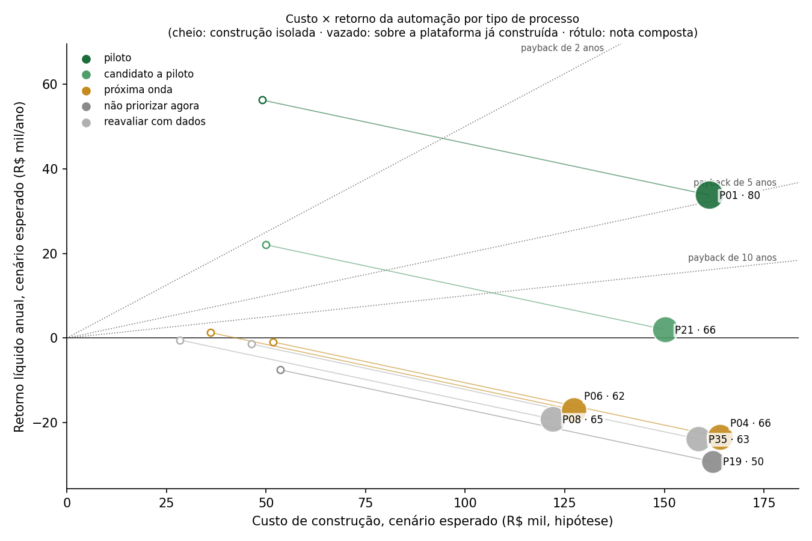

# Priorização da automação: matriz de critérios e custo × retorno

Gerado por `scripts/priorizacao_automacao.py`. Os números vêm das saídas verificadas do mapeamento; as premissas de custo e de fração automatizável são **hipótese até a medição no piloto** e estão na aba “Premissas” da planilha `saida/fase4/Priorizacao_Automacao.xlsx`. Horas de trabalho são hipótese até a calibração com os servidores.

## 1. O que o mapeamento ensinou para a automação

- **O volume por tipo de processo é baixo.** Estimado a partir das deliberações de toda a agência, 2 de 7 tipos com volume medido chegam a 25 processos por ano (P01: 51,1, P21: 39,9); N01, P07, P18, P22 ficam sem volume medido. Automação do processo inteiro só se paga onde há repetição; nos demais tipos, o retorno vem de capacidades compartilhadas (seção 4).
- **A espera pesa tanto quanto o trabalho.** A soma das esperas entre atividades vai de 41% a 89% do lead time mediano dos casos nativos, conforme o tipo. Automatizar a redação e a análise reduz horas; o prazo só cai se o sistema também vigiar posse, prazos e pendências.
- **Nenhum fluxo é padronizado.** O caminho mais frequente cobre de 9% a 50% dos casos da coorte. O sistema deve automatizar por atividade, disparado pelo gatilho de cada tarefa do modelo, e não impor uma sequência fixa.
- **A IA julga melhor quando a regra está escrita.** As etapas que passaram nos portões tinham especificação prévia, saída em formato fixo e conferência automática ou às cegas; o mesmo vale para o sistema: cada atividade automatizada precisa de uma regra computável e de um conjunto de casos de referência.
- **Tempo de terceiros e prazo legal não são ganho.** A espera pela regulada e o prazo mínimo da norma ficam fora do retorno; o sistema pode cobrar prazos vencidos, não encurtar o que a lei concede.
- **A análise mistura texto e dado.** Nas peças de análise, a fração com dado não estruturado vai de 85% a 100% e a com dado estruturado, de 5% a 36%, conforme o tipo. O sistema precisa extrair do texto e conferir contra a regra e o cálculo.

## 2. Critérios e régua

| Critério | Peso | O que mede | Cortes para as notas 2, 3, 4 e 5 |
|---|---|---|---|
| Volume | 25% | Processos por ano na agência: piso de deliberações ÷ (fração com deliberação × revocação da regra) | 5 · 10 · 25 · 50 |
| Foco em análise | 15% | Fração das horas do tipo em peças de análise (jurídica, técnica, econômica, conferência, relatoria) | 0,20 · 0,35 · 0,50 · 0,65 |
| Dados estruturados e não estruturados | 15% | Peças de análise com dado estruturado (cálculo, base, sistema) e com não estruturado (documento da regulada, precedente, documentos examinados): média das duas frações | 0,30 · 0,45 · 0,60 · 0,75 |
| Regras claras | 20% | Peças de análise ancoradas em norma ou contrato e com teste contra um padrão: média das duas frações | 0,40 · 0,55 · 0,70 · 0,85 |
| Padronização | 15% | Texto padronizado ou transcrito (ponderado por horas) e fração dos casos no caminho mais frequente | 0,30 · 0,40 · 0,50 · 0,60 |
| Completude da automação | 10% | Fração das horas dos casos em atividades com potencial de IA alto na avaliação AS-IS | 0,20 · 0,35 · 0,50 · 0,65 |

Nota composta = Σ peso × nota ÷ 5 (0 a 100). Portões do piloto de automação completa: volume medido com revocação ≥ 75%, nota de volume ≥ 3, nota de regras ≥ 3 e ao menos 8 casos na coorte.

## 3. Matriz

| Código | Processo | Prioridade | Nota | V | A | D | R | P | C | Volume/ano | Retorno/ano (R$) | Construção (R$) | Payback isolado (anos) | Payback com plataforma (anos) |
|---|---|---|---|---|---|---|---|---|---|---|---|---|---|---|
| P01 | Reajuste tarifário anual | piloto | 80,0 | 5 | 5 | 4 | 3 | 2 | 5 | 51,1 | 66.075 | 161.270 | 4,8 | 0,9 |
| P21 | Apuração de ocorrência de usuário pelo Conselho-Diretor | candidato a piloto | 66,0 | 4 | 5 | 3 | 3 | 2 | 2 | 39,9 | 32.052 | 150.140 | 75,0 | 2,3 |
| P04 | Homologação de planos de investimento e obras | próxima onda | 66,0 | 2 | 5 | 3 | 4 | 2 | 5 | 8,6 | 9.438 | 163.970 | — | — |
| P06 | Fiscalização técnica de campo (programada e por demanda) | próxima onda | 62,0 | 2 | 5 | 3 | 3 | 2 | 5 | 7,6 | 8.515 | 127.340 | — | 28,1 |
| P19 | Regulação do mercado livre de gás (CUSD e migração) | não priorizar agora | 50,0 | 1 | 4 | 3 | 3 | 2 | 3 | 2,6 | 3.208 | 162.140 | — | — |
| P08 | Monitoramento de metas contratuais e do IDG (verificador independente) | reavaliar com dados | 65,0 | 3 | 5 | 3 | 4 | 2 | 2 | 10,0 | 5.220 | 121.940 | — | — |
| P35 | Gestão de interrupções e crises de abastecimento | reavaliar com dados | 63,0 | 3 | 5 | 3 | 3 | 2 | 3 | 11,8 | 7.857 | 158.540 | — | — |
| N01 | Acompanhamento ambiental e de mananciais das concessões | reavaliar com dados | — | — | 4 | 3 | 4 | 2 | 5 | — | — | 150.140 | — | — |
| P07 | Processo sancionador (auto de infração à cobrança da multa) | reavaliar com dados | — | — | 4 | 4 | 3 | 3 | 5 | — | — | 160.340 | — | — |
| P18 | Prorrogação, relicitação e alteração de concessões | reavaliar com dados | — | — | 2 | 4 | 2 | 4 | — | — | — | 114.500 | — | — |
| P22 | Resposta a órgãos de controle e ao Ministério Público | reavaliar com dados | — | — | 3 | 3 | 4 | 2 | 5 | — | — | 144.140 | — | — |

V volume · A foco em análise · D dados estruturados e não estruturados · R regras claras · P padronização · C completude da automação. Valores monetários no cenário esperado; os três cenários estão em `saida/fase4/matriz_automacao.json`. Payback com plataforma = só a configuração das atividades, com a plataforma e as capacidades de IA já construídas para outro tipo. Payback vazio = o retorno anual não cobre o custo anual.

## 4. Capacidades transversais

Uma capacidade de IA construída uma vez serve a vários tipos de processo. A tabela soma, por capacidade, as atividades de potencial alto ou médio que a usam e as horas por ano que elas alcançam (só tipos com volume medido).

| Capacidade | Tipos | Atividades | Horas/ano alcançadas | Horas de construção |
|---|---|---|---|---|
| redação assistida de minuta | 11 | 83 | 4.507,1 | 80 |
| verificação de conformidade | 10 | 36 | 3.179,3 | 100 |
| sumarização e linha do tempo | 11 | 37 | 3.122,4 | 40 |
| busca de precedentes e normas | 10 | 28 | 3.008,8 | 60 |
| extração de dados de documentos | 11 | 34 | 1.143,5 | 80 |
| monitoramento de prazos e alertas | 11 | 54 | 908,9 | 24 |
| cálculo e conferência automática | 7 | 12 | 784,2 | 80 |
| automação de tramitação (RPA no SEI) | 11 | 49 | 575,0 | 40 |
| classificação e triagem | 9 | 13 | 299,0 | 60 |
| painel e indicadores | 8 | 12 | 69,7 | 24 |

## 5. Recomendação

**Piloto: P01 — Reajuste tarifário anual.** É o tipo com maior nota composta (80,0) entre os que passam em todos os portões: volume estimado de 51,1 processos por ano, 13 de 16 atividades com potencial de IA alto ou médio e 10 capacidades de IA. No cenário esperado, libera 1.262,5 horas por ano (66.075 reais) para uma construção de 161.270 reais, payback de 4,8 anos isolado e 0,9 anos se a plataforma e as capacidades já existirem.
Nos extremos, o payback isolado vai de 0,7 anos (otimista) a nunca (conservador): o conservador soma horas no piso, fração automatizável baixa e desenvolvimento caro. A medição no piloto decide entre eles.

Também passam nos portões: P21 (Apuração de ocorrência de usuário pelo Conselho-Diretor, nota 66,0; payback esperado de 75,0 anos isolado e 2,3 anos sobre a plataforma do piloto). É a segunda onda natural: reaproveita a plataforma e as capacidades.

Próxima onda (nota ≥ 60, falha num portão): P04 (volume abaixo do portão); P06 (volume abaixo do portão).

## 6. O que o método já entrega para especificar o sistema do piloto

| Insumo | Quantidade | Onde está |
|---|---|---|
| Tarefas do modelo, com gatilho e saída | 16 de 16 | `saida/bpmn/modelo_P01.json` |
| Pontos de decisão | 4 | idem |
| Atividades com potencial de IA alto ou médio, com tipos de IA | 13 de 16 | `saida/bpmn/avaliacao_P01.json` |
| Casos nativos para o conjunto de referência | 18 | `saida/fase2/casos_P01.json` |
| Peças com ficha de trabalho (insumos, testes, cálculos) | 476 | `saida/fichas_trabalho.jsonl` |
| Requisitos normativos com teste computável | 20 de 20 | `saida/fase3/normas_P01.json` |
| Requisitos medidos na coorte (conformidade mediana de 70,6%) | 13 | `saida/fase3/conformidade_P01.json` |
| Melhorias do TO-BE simuladas | 18 | `saida/fase3/melhorias_P01.json` |
| Indicadores, controles de qualidade da IA e testes de auditoria contínua | 10, 4 e 7 | `saida/fase3/controles_P01.json` |

Cada tarefa vira um caso de uso (gatilho → entrada → regra → saída); cada requisito com teste vira uma verificação automática; os casos nativos, rotulados por servidor, formam o conjunto de aceite; os indicadores e controles medem o sistema em produção.

O retorno em horas é só parte do valor: prazo, conformidade e rastreabilidade não estão monetizados. O piloto deve medir, antes e depois, a fração automatizável real por atividade e o custo efetivo de construção, e com isso substituir as premissas desta matriz.

## 7. Limites

- O volume é estimado a partir de deliberações; tipos que raramente chegam à deliberação ficam sem medida.
- A fração automatizável por potencial de IA, as horas de construção e o custo-hora de desenvolvimento são hipóteses; o retorno escala linearmente com elas.
- As horas por caso vêm das fichas por peça (estimativa, piso e teto) e são hipótese até a calibração.
- Coortes pequenas dão medianas instáveis: a coluna de casos na coorte diz quanto confiar.
- Ficam fora da matriz, por não terem avaliação AS-IS: P20. Tipos que quase não chegam ao Conselho, como o atendimento de manifestações, podem ter volume real bem maior do que a base do gabinete mostra; medir com outra fonte (sistema da Ouvidoria) antes de descartá-los.
